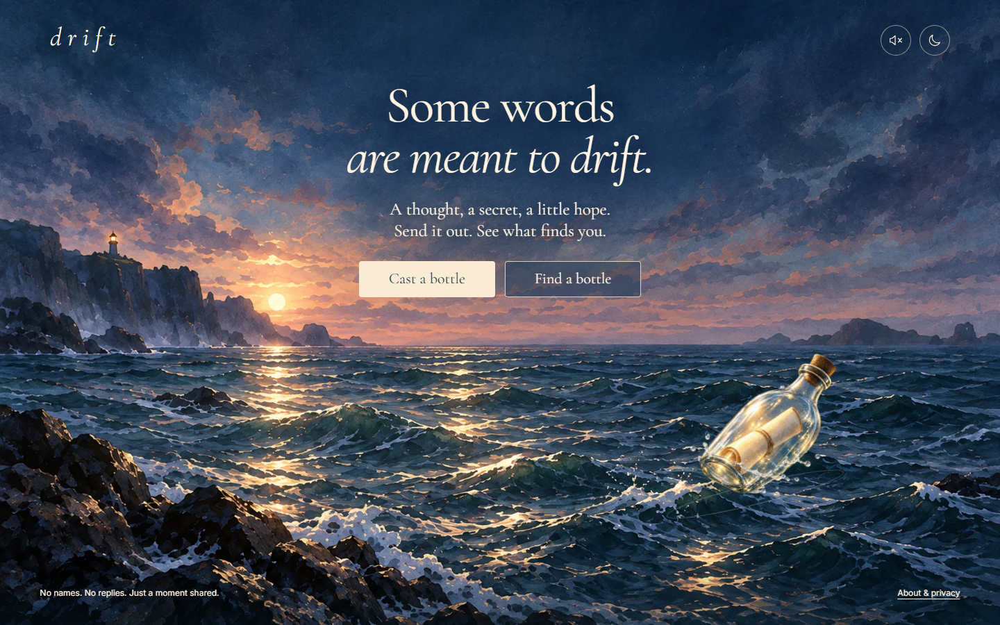
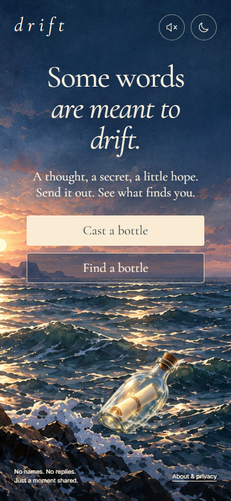

# Drift

*Some words are meant to drift.*

A quiet, anonymous sea for a thought, a secret, a little hope. Cast a message in a bottle. Open a message left by a stranger. No accounts, replies, followers, history or read receipts.

**Release status:** implementation is verified locally; official Cloudflare Git integration and production verification are in progress. A live link will appear here only after verification. This is the only source repository.



<p align="center"> </p>

## A small moment of connection

- Write in English, Chinese or any Unicode text, up to 500 characters. Messages render as plain text.
- Fold, seal and cast your bottle; watch another drift ashore and unfold. Rituals begin only after API success and can be skipped.
- Read once per anonymous 24-hour visit. Your own bottles stay out of your draw pool.
- Report harmful content. Three distinct sessions' reports pause a bottle for local operator review.
- Ocean sound is opt-in and synthesized locally. Turn atmosphere off, use the keyboard, or rely on your device's reduced-motion preference. Background tabs pause sound and movement.

The watercolor sea and transparent glass bottle were created for Drift. All interface text is native HTML. [Design and asset provenance](docs/design/assets.md).

## Run locally

Requires Node 24 and npm. No cloud credentials are needed for local development or tests.

```sh
npm ci
npm run db:local
npm run build
npm run dev:api
# In a second terminal:
npm run dev
```

Open `http://127.0.0.1:5173`. Vite proxies relative `/api/*` requests to the local Worker. To use the built static app directly, run Wrangler with `--var ALLOWED_ORIGIN:http://127.0.0.1:8787`. Local cookies intentionally use a non-production name over loopback HTTP.

```sh
npm run typecheck
npm run lint
npm test
node scripts/check-migrations.mjs
npx playwright install chromium
npm run test:e2e
```

Tests use independent local databases. E2E covers 360, 390, 768 and 1440px, keyboard/focus, Unicode length, plain-text injection protection, two anonymous browser contexts, error recovery, reduced motion and accessibility. Local fixed mobile simulation measured 1.19s to interactive, 2.30s LCP and 0.0075 CLS (three-run medians; [method and raw results](docs/evidence/performance.json)). These are not physical-device or field measurements.

## Architecture

React + TypeScript + Vite, CSS design tokens, lazy GSAP rituals and native Web Audio. A single Cloudflare Worker serves Static Assets and JSON APIs. The API namespace never falls through to SPA HTML.

| Route | Purpose |
| --- | --- |
| `GET /api/bootstrap` | Issue a signed short-lived cookie and bound CSRF token; no database write |
| `POST /api/session` | Initialize anonymous session after exact-Origin and CSRF checks |
| `POST /api/bottles` | Idempotent submission and fail-closed rule moderation |
| `POST /api/draw` | Weighted candidate selection; return only a five-minute credential |
| `POST /api/open` | Recheck approval, consume credential and count exposure atomically |
| `POST /api/report` | Record one report per opened bottle/session |

D1 stores messages, expiring sessions, draw credentials, deduplication records and rate limits. Sampling traverses every eligible candidate with weight `1 / (1 + exposure_count)^1.5`. D1 triggers ensure concurrent and repeated opens count only once. Exposure counts never reach the browser.

All mutations require POST, JSON, exact Origin and a session-bound CSRF token. Remote cookies use `__Host-`, HttpOnly, Secure, SameSite=Strict and Path=/. Content responses use no-store. Raw IP addresses are not stored; a daily rotating keyed hash supports IP limits. Anonymous session links expire after 24 hours and are cleaned hourly. There is no analytics or persistent fingerprint.

## Release, moderation and recovery

[Operations guide](docs/operations.md) covers actual environments, Cloudflare Git integration, immutable migrations, encrypted seven-day backups, operator review, release locks, incident recovery and scale limits. [Delivery evidence](docs/delivery.md) records actual checks and outstanding validation.

GitHub Actions verifies only. Official Cloudflare Git builds deploy only after the exact commit passes required checks. Preview and production have separate D1 bindings, secrets and Origins. Stale commits, failed checks, failed backups and failed migrations block deployment. Production never receives seeds or test suites.

```sh
npm run moderate -- production list
npm run moderate -- production hide <exact-bottle-id>
npm run moderate -- production approve <exact-bottle-id>
```

These operator commands require Cloudflare credentials. Never capture message review output in public CI logs. Rule-based moderation is limited and requires human review of reports. Anonymous sessions are not verified identities.

Database restore is explicitly destructive and requires incident approval, paused writes, a fresh backup and an acknowledged data-loss window. It is never triggered automatically. The isolated Time Travel rehearsal succeeded; [evidence](docs/evidence/recovery-drill.json).
